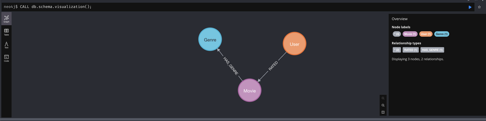
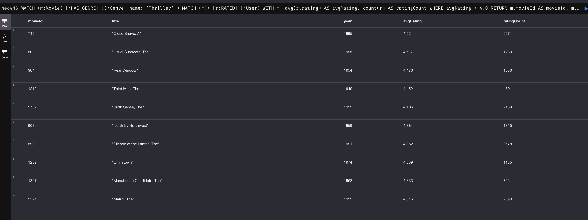
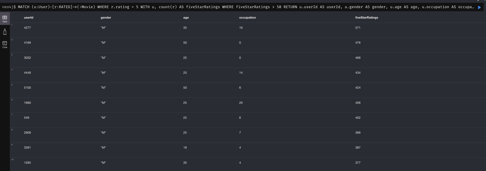
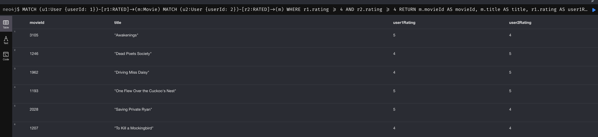
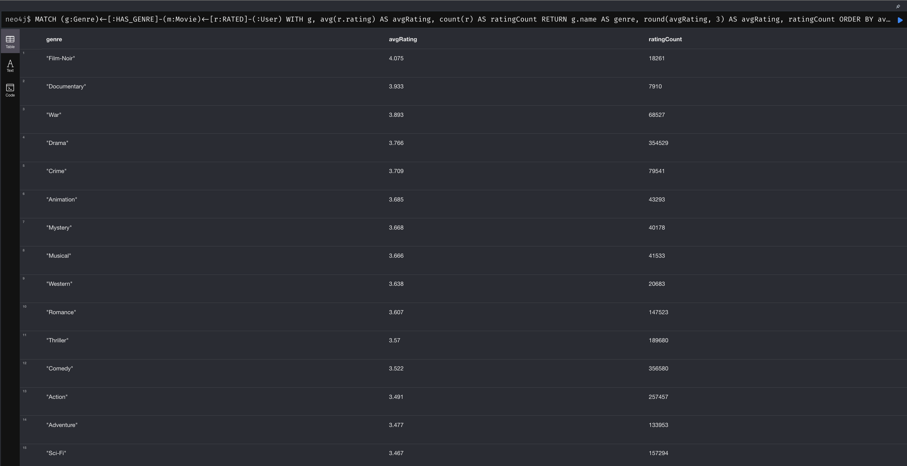
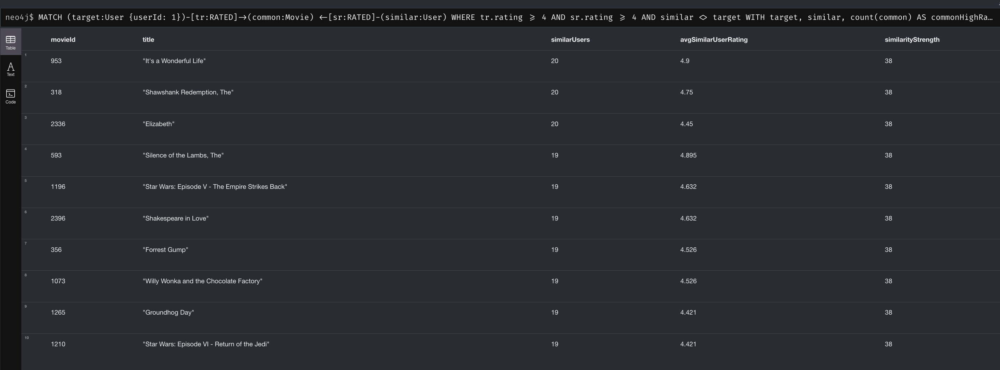
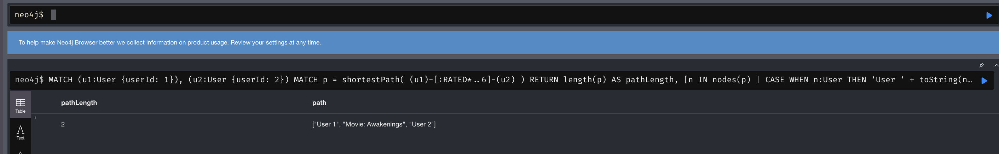
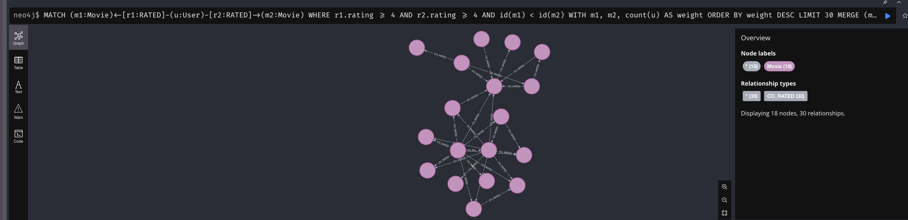
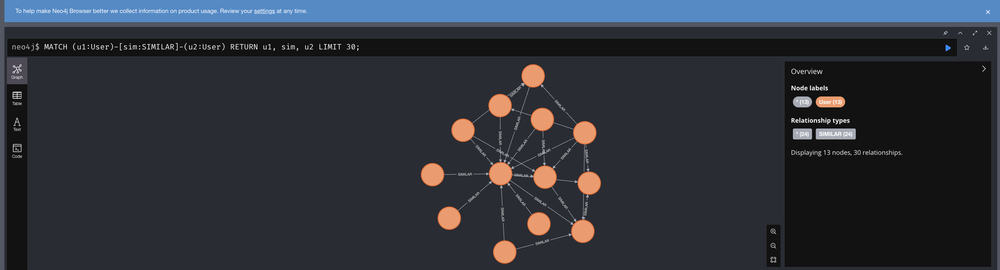

# NoSQL Homework 3 — Knowledge Graph for a Recommendation System

## Project overview

У цьому проєкті побудовано графову модель рекомендаційної системи на основі **MovieLens 1M** у **Neo4j**.

Dataset містить:

- 6 040 користувачів
- 3 883 фільми
- 1 000 209 оцінок
- 18 жанрів

У роботі реалізовано:

- конвертацію MovieLens `.dat` у UTF-8 CSV
- завантаження вузлів і зв'язків у Neo4j
- індекси для основних ідентифікаторів
- 6 Cypher-запитів
- аналіз супервузлів
- PageRank
- Louvain community detection
- Dijkstra shortest path
- аналіз Graph vs SQL

---

## Repository structure

```text
.
├── docker-compose.yml
├── convert.py
├── import/
│   ├── movies.csv
│   ├── users.csv
│   └── ratings.csv
├── queries/
│   ├── part2_load.cypher
│   ├── part3.cypher
│   ├── part4_supernodes.cypher
│   └── part5_gds.cypher
├── screenshots/
│   ├── schema.png
│   ├── part3_query1.png
│   ├── part3_query2.png
│   ├── part3_query3.png
│   ├── part3_query4.png
│   ├── part3_query5.png
│   ├── part3_query6.png
│   ├── part5_pagerank_graph.png
│   └── part5_similarity_graph.png
└── README.md
```

---

# Environment setup

Neo4j запускається локально через Docker.

Використано:

```text
Neo4j 5.18.1
APOC 5.18.0
Graph Data Science 2.6.9
```

Запуск:

```bash
docker compose up -d
```

Neo4j Browser:

```text
http://localhost:7474
```

Перевірка плагінів:

```cypher
RETURN apoc.version() AS apoc, gds.version() AS gds;
```

Фактичний результат:

```text
APOC: 5.18.0
GDS: 2.6.9
```

---

# Dataset preparation

MovieLens 1M було завантажено та розпаковано локально.

Початкові файли:

```text
movies.dat
users.dat
ratings.dat
```

Вони використовують:

```text
delimiter: ::
encoding: Latin-1
```

Скрипт `convert.py` конвертує їх у UTF-8 CSV:

```text
import/movies.csv
import/users.csv
import/ratings.csv
```

---

# Part 1 — Graph schema design

## Graph model

```text
(User)
  |
  | RATED {rating, timestamp}
  v
(Movie)
  |
  | HAS_GENRE
  v
(Genre)
```

Властивості:

```text
User:
- userId
- gender
- age
- occupation

Movie:
- movieId
- title
- year

Genre:
- name

RATED:
- rating
- timestamp
```

Схема з Neo4j Browser:



---

## 1. Які сутності стали вузлами, а які — ребрами?

Вузлами стали `User`, `Movie` та `Genre`, тому що це самостійні сутності, які мають власні властивості та можуть брати участь у багатьох зв'язках.

`RATED` реалізовано як зв'язок між `User` і `Movie`, тому що рейтинг має сенс саме як взаємодія конкретного користувача з конкретним фільмом.

`HAS_GENRE` є зв'язком між `Movie` та `Genre`.

Така модель дозволяє природно обходити граф у різних напрямках: від користувача до фільмів, від фільму до користувачів або від фільмів до жанрів.

---

## 2. Rating як relationship чи окремий node?

У цій роботі рейтинг реалізовано як:

```text
(User)-[:RATED {rating, timestamp}]->(Movie)
```

Для MovieLens це більш природна модель, тому що кожна оцінка описує один факт взаємодії між двома існуючими сутностями.

Переваги relationship:

- коротший шлях між `User` і `Movie`
- простіші Cypher-запити
- менше вузлів у графі
- `rating` і `timestamp` логічно належать саме до взаємодії

Окремий `Rating` node був би доцільнішим, якби оцінка мала складну власну структуру: коментарі, історію редагування, джерело, статус модерації або інші зв'язки.

Для MovieLens така складність не потрібна.

---

## 3. Чому Genre — окремий node?

Якби жанри були тільки списком у `Movie`, було б зручно читати один фільм, але складніше виконувати графові обходи між жанрами, фільмами та користувачами.

Окремий `Genre` дозволяє:

- швидко знаходити всі фільми конкретного жанру
- переходити `Genre → Movie → User`
- аналізувати жанри community користувачів
- використовувати жанр як повноцінну частину графової структури

Недолік — популярні жанри можуть перетворитися на супервузли. Це аналізується у Part 4.

---

# Part 2 — Data loading

Для захисту від дублювання при повторному запуску використовується `MERGE`.

Індекси створено для:

```text
User.userId
Movie.movieId
Genre.name
```

Індекси створюються до масового завантаження `RATED`, щоб Neo4j швидше знаходив відповідні `User` та `Movie`.

Оцінки завантажувалися через:

```text
apoc.periodic.iterate
```

з параметрами:

```text
batchSize = 10000
parallel = false
```

Результат завантаження:

```text
batches: 101
total: 1000209
failedBatches: 0
failedOperations: 0
```

Фінальні counts:

```text
Users:              6040
Movies:             3883
Genres:             18
RATED:              1000209
HAS_GENRE:          6408
```

---

# Part 3 — Cypher queries

## Query 1 — Thriller movies with average rating > 4.0

Запит знаходить фільми жанру `Thriller`, агрегує всі `RATED` relationships та залишає тільки фільми із середнім рейтингом вище `4.0`.

Top results:

```text
Close Shave, A                4.521
Usual Suspects, The           4.517
Rear Window                   4.476
Third Man, The                4.452
Sixth Sense, The              4.406
```



---

## Query 2 — Users with more than 50 ratings of 5

Запит фільтрує тільки relationships, де:

```text
rating = 5
```

після чого групує їх за користувачем.

Найбільше п'ятірок поставив:

```text
User 4277 — 571
```



---

## Query 3 — Movies highly rated by both User 1 and User 2

Запит знаходить спільні Movie nodes для двох користувачів, де обидві оцінки не нижчі за `4`.

Результат:

```text
Awakenings
Dead Poets Society
Driving Miss Daisy
One Flew Over the Cuckoo's Nest
Saving Private Ryan
To Kill a Mockingbird
```



---

## Query 4 — Genres with consistently high ratings

Запит проходить:

```text
Genre <- HAS_GENRE - Movie <- RATED - User
```

та для кожного жанру обчислює:

```text
average rating
rating count
```

Найвищі середні рейтинги:

```text
Film-Noir     4.075
Documentary   3.933
War           3.893
Drama         3.766
Crime         3.709
```

Важливо дивитися не тільки на average, але й на кількість оцінок, оскільки невеликий жанр може мати високий average на значно меншій вибірці.



---

## Query 5 — Recommendation through similar users

Логіка рекомендації:

1. беремо `User 1`
2. знаходимо інших користувачів, які також високо оцінили ті самі фільми
3. залишаємо користувачів з достатньою кількістю спільних high-rated movies
4. беремо фільми, які вони оцінили високо
5. виключаємо фільми, які target user вже дивився

Top recommendations:

```text
It's a Wonderful Life
Shawshank Redemption, The
Elizabeth
Silence of the Lambs, The
Star Wars: Episode V - The Empire Strikes Back
Shakespeare in Love
Forrest Gump
Willy Wonka and the Chocolate Factory
Groundhog Day
Star Wars: Episode VI - Return of the Jedi
```



---

## Query 6 — Shortest path between two users

Для User 1 та User 2:

```text
User 1
  ↓
Awakenings
  ↓
User 2
```

Фактичний результат:

```text
pathLength = 2
```



---

## Що означає довжина шляху?

У базовому графі один hop — це один `RATED` relationship.

Шлях довжини `2`:

```text
User → Movie → User
```

означає, що два користувачі оцінювали один і той самий фільм.

Шлях довжини `4`:

```text
User A
→ Movie 1
→ User B
→ Movie 2
→ User C
```

означає, що `User A` та `User C` пов'язані через одного проміжного користувача.

Шлях довжини `6` містить вже двох проміжних користувачів і три Movie nodes.

Чим коротший шлях, тим тісніше користувачі пов'язані через історію оцінювання.

---

# Part 4 — Supernodes

Для пошуку супервузлів було підраховано degree кожного node.

## Найбільші nodes

Top results:

```text
American Beauty                                  degree 3430
Star Wars: Episode V - The Empire Strikes Back  degree 2995
Star Wars: Episode IV - A New Hope              degree 2995
Star Wars: Episode VI - Return of the Jedi      degree 2888
Jurassic Park                                    degree 2675
```

Для `American Beauty`:

```text
RATED relationships = 3428
```

Решта degree походить від `HAS_GENRE`.

Найактивніший користувач:

```text
User 4169
RATED relationships = 2314
```

---

## Genre supernodes

Найбільші Genre nodes:

```text
Drama      1603 movies
Comedy     1200
Action      503
Thriller    492
Romance     471
```

Отже, `Drama` і `Comedy` також є супервузлами відносно інших жанрів.

---

## Чому supernode може бути повільним?

Індекс допомагає знайти сам node, але після того, як Neo4j його знайшов, traversal все одно повинен переглянути relationships цього node.

Наприклад:

```cypher
MATCH (:Genre {name:'Drama'})<-[:HAS_GENRE]-(m)
RETURN m;
```

Lookup `Drama` може бути швидким через index, але після цього Neo4j все одно повинен пройти приблизно `1603` relationships.

Для звичайного Genre node з кількома десятками relationships такий traversal буде значно дешевшим.

Тобто index оптимізує пошук стартового node, але не усуває вартість обходу великої adjacency list.

---

## Стратегія роботи із supernodes

Для цього dataset я б застосувала selective denormalization.

Наприклад, для простих genre filters жанри можна додатково дублювати у `Movie`:

```text
Movie.genres
```

при цьому `Genre` nodes залишити для складних graph traversals.

Інший варіант — додаткове partitioning популярних категорій, наприклад за жанром і десятиліттям, якщо типові запити одночасно фільтрують за genre та year.

Такі оптимізації варто застосовувати тільки після profiling реальних запитів, оскільки вони ускладнюють модель.

---

# Part 5 — Graph Data Science

## 5.1 PageRank

Спочатку матеріалізуються relationships:

```text
(Movie)-[:CO_RATED {weight}]-(Movie)
```

де `weight` — кількість користувачів, які високо оцінили обидва фільми.

До GDS projection передано:

```text
nodes:           3883
relationships: 100000
```

`100000` relationships у projection відповідає `50000` materialized pairs при `UNDIRECTED` orientation.

Top PageRank:

```text
1. American Beauty                                   9.6588
2. Star Wars: Episode IV - A New Hope               9.1363
3. Star Wars: Episode V - The Empire Strikes Back   9.1005
4. Raiders of the Lost Ark                          7.9385
5. Fargo                                             7.0317
6. Silence of the Lambs, The                        6.7142
7. Godfather, The                                    6.3140
8. Shawshank Redemption, The                        6.2948
9. Matrix, The                                       6.2876
10. Sixth Sense, The                                 6.2459
```



### Що означає високий PageRank?

У цьому графі високий PageRank не означає просто, що фільм має багато ratings.

Він означає, що Movie добре інтегрований у мережу інших фільмів, які ті самі користувачі часто оцінювали високо.

Тобто PageRank залежить не тільки від кількості connections, але й від центральності сусідніх Movie nodes.

---

# 5.2 Louvain community detection

Початковий варіант:

```text
rating >= 4
LIMIT 50000
```

перевищив локальний Neo4j transaction memory limit.

Отримана помилка:

```text
dbms.memory.transaction.total.max threshold reached
```

Тому для локального запуску було використано спрощення:

```text
rating = 5
LIMIT 20000
```

Це відповідає рекомендації завдання зменшити `LIMIT` або підвищити поріг rating, якщо повний similarity graph занадто важкий для локального середовища.

GDS projection:

```text
nodes:          6040
relationships: 40000
```

Фінальний контрольний запуск Louvain:

```text
communityCount:         5106
modularity:             0.1721375
ranLevels:              2
nodePropertiesWritten:  6040
```

Найбільші communities:

```text
538 users
191 users
174 users
35 users
```

Багато інших користувачів залишилися singleton communities.

---

## Top genres by community

Найбільший cluster:

```text
Drama     50350
Comedy    39521
Action    25394
```

Другий cluster:

```text
Comedy    21283
Drama     19354
Action    17889
```

Третій cluster:

```text
Drama       27069
Comedy      19486
Thriller     9413
```



---

## Чи відповідають clusters інтуїтивним групам?

Частково.

У великих communities повторюються `Drama` і `Comedy`, тому не можна сказати, що Louvain створив абсолютно чисті групи на кшталт «тільки любителі бойовиків» або «тільки цінителі арт-хаусу».

Проте третя позиція і співвідношення жанрів відрізняються.

Наприклад:

```text
community 1 → Drama / Comedy / Action
community 2 → Comedy / Drama / Action
community 3 → Drama / Comedy / Thriller
```

Отже, clusters швидше відображають різні пропорції смаків, а не взаємовиключні жанрові профілі.

Перевірка виконувалася через aggregation жанрів фільмів з `rating >= 4` окремо для users кожної community.

---

# 5.3 Dijkstra shortest path

Для shortest path використано той самий user similarity graph.

Для Dijkstra `weight` не використовувався як cost.

Причина:

```text
більший weight = сильніша similarity
```

але Dijkstra мінімізує cost.

Якби `weight` використовувався напряму, сильніший similarity relationship став би дорожчим, що суперечить змісту цієї метрики.

Для аналізу degrees of separation кожен `SIMILAR` relationship тому має cost `1`.

---

## Приклад

Для:

```text
User 17
User 181
```

отримано:

```text
17 → 4277 → 181
pathLength = 2
```

---

## Декілька тестових пар

```text
17  → 181    length 2
33  → 175    length 2
81  → 169    length 2
139 → 166    length 2
151 → 157    length 2
```

Результат:

```text
testedPairs:        5
averagePathLength:  2.0
minPathLength:      2.0
maxPathLength:      2.0
```

---

## Наскільки «тісний світ»?

Для перевірених пар усередині найбільшої connected community граф виявився дуже тісним: кожна пара мала тільки одного проміжного користувача.

Середня довжина:

```text
2.0
```

Це значно менше шести.

Проте цей результат не можна автоматично узагальнювати на всі `6040` users.

Similarity graph був навмисно розріджений через memory constraint:

```text
rating = 5
LIMIT 20000
```

а тестові пари були вибрані всередині великої connected community.

Тому коректний висновок: для перевіреної connected subset фактичні шляхи значно коротші за `6`, але для статистичного висновку по всьому dataset потрібне ширше тестування всіх reachable pairs.

---

# Part 6 — Analysis and conclusions

## 1. Graph vs SQL

Найсильніша перевага графової моделі проявляється у Query 5 та Query 6.

Прості aggregation queries на кшталт середнього рейтингу жанру SQL також виконує дуже добре.

Але recommendation через users зі схожими смаками або shortest path вимагають багатокрокових traversals.

У Cypher shortest path записується компактно:

```cypher
MATCH p = shortestPath(
    (u1)-[:RATED*..6]-(u2)
)
RETURN p;
```

У SQL для аналогічної задачі потрібен recursive CTE, контроль циклів та явне представлення graph edges у таблицях.

Концептуально SQL міг би починатися так:

```sql
WITH RECURSIVE paths AS (
    SELECT
        user_id AS start_user,
        movie_id,
        1 AS depth
    FROM ratings
    WHERE user_id = 1

    UNION ALL

    SELECT
        p.start_user,
        r2.movie_id,
        p.depth + 2
    FROM paths p
    JOIN ratings r1
        ON r1.movie_id = p.movie_id
    JOIN ratings r2
        ON r2.user_id = r1.user_id
    WHERE p.depth < 6
)
SELECT *
FROM paths;
```

У реальному SQL-запиті потрібно було б додатково уникати циклів, зберігати visited nodes і відновлювати сам path.

У Neo4j relationships та traversals є основними елементами моделі, тому такі задачі виражаються природніше.

---

## 2. Де graph програє?

Реляційна модель була б зручнішою для:

- великих звітних таблиць
- експорту даних
- простих агрегатів по всіх ratings
- BI-запитів
- статистики за датами
- масових tabular transformations

Наприклад, задача:

```text
average rating by year and gender
```

природно реалізується через SQL:

```text
GROUP BY year, gender
```

і не потребує складних graph traversals.

Тому практична архітектура може комбінувати:

```text
relational / analytical storage
+
graph database for relationship-heavy queries
```

---

## 3. Як можна покращити schema?

### Query 5 — Recommendations

Найдорожча частина Query 5 — повторне знаходження similar users через спільні Movie nodes.

У production system можна періодично матеріалізувати:

```text
(User)-[:SIMILAR {score}]->(User)
```

Тоді online recommendation query не потребуватиме кожного разу проходити через велику кількість `RATED` relationships.

Trade-off — `SIMILAR` потрібно оновлювати після появи нових ratings.

### Query 1 / Query 4 — Aggregate ratings

Якщо average rating та rating count використовуються дуже часто, їх можна періодично матеріалізувати у `Movie`:

```text
Movie.avgRating
Movie.ratingCount
```

Це зменшить кількість `RATED` relationships, які потрібно проходити для read-heavy queries.

Недолік — агрегати потрібно підтримувати актуальними при нових ratings.

### Genre supernodes

Для простого genre filtering можна також застосувати selective denormalization:

```text
Movie.genres
```

залишивши `Genre` nodes для graph traversal.

Таким чином одна й та сама інформація може бути оптимізована під різні типи workload.

---

# Final conclusions

У межах роботи побудовано повний knowledge graph рекомендаційної системи на MovieLens 1M.

Фактично завантажено:

```text
6040 User nodes
3883 Movie nodes
18 Genre nodes
1000209 RATED relationships
6408 HAS_GENRE relationships
```

Реалізовано:

```text
6 Cypher queries
supernode analysis
PageRank
Louvain
Dijkstra
```

Graph database особливо зручна тоді, коли задача формулюється через relationships та paths.

У цьому dataset це:

```text
similar users
shared movies
recommendations
shortest paths
communities
central movies
```

Для простих масових aggregations реляційна модель часто простіша, але для багатокрокових relationship-heavy queries Neo4j дає природнішу модель і значно коротші запити.